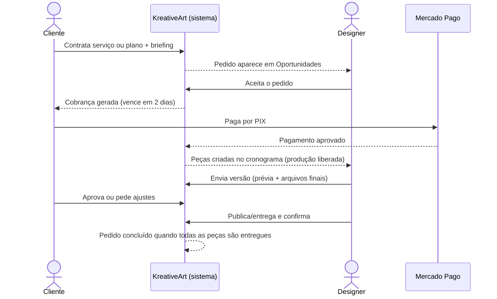
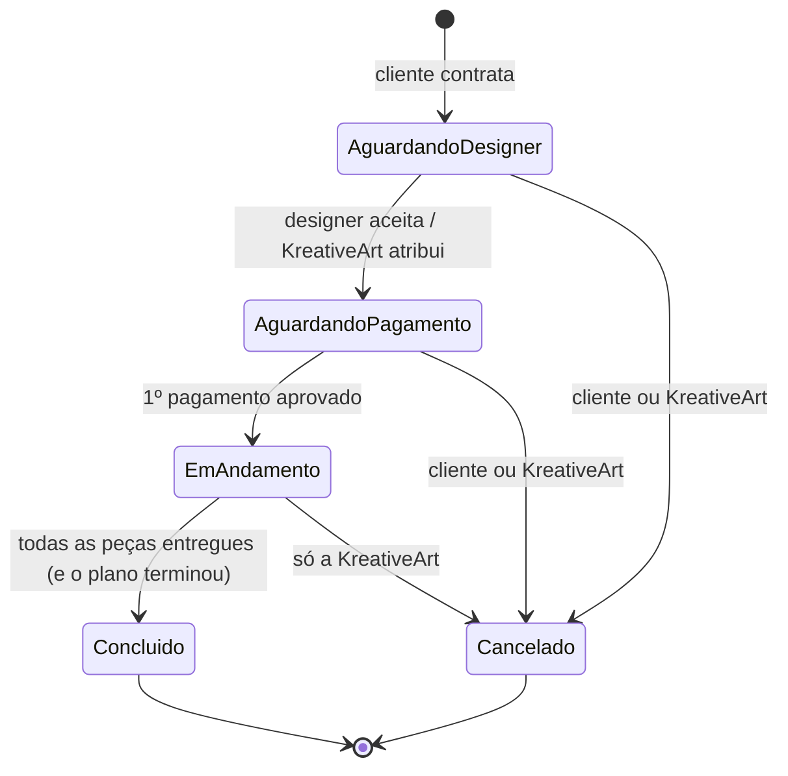
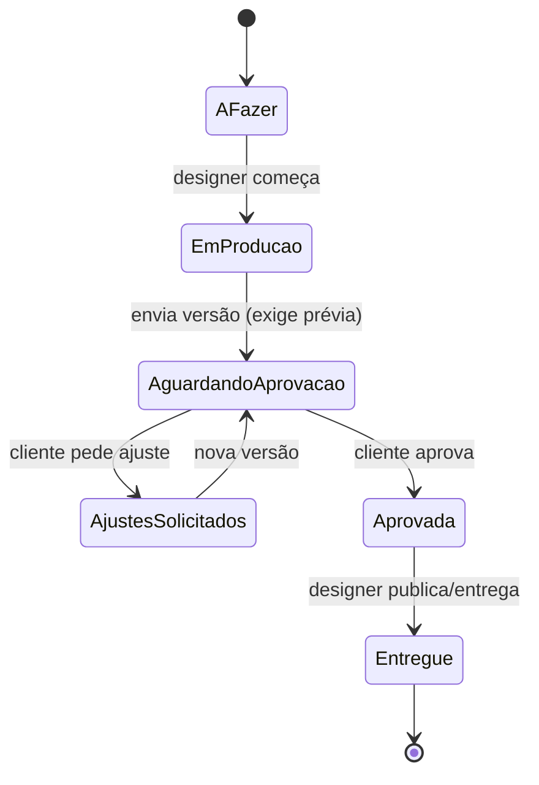
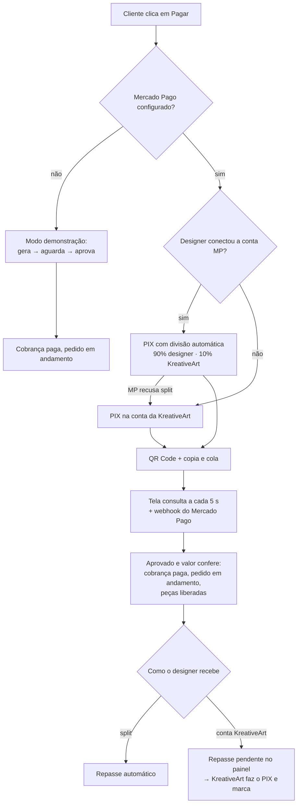

# 2. Fluxos e casos de uso

## 2.1 Jornada completa

## 2.2 Situações do pedido

**Planos mensais:** a rotina diária (roda a cada acesso ao servidor) gera a mensalidade e as peças de cada mês. Se a mensalidade atrasar além da tolerância (5 dias), as peças do mês ficam **pausadas** e o designer não é cobrado pelo prazo delas.

## 2.3 Produção de uma peça (quadro do designer)

Os arquivos finais (PSD, AI, CDR…) só ficam disponíveis para o cliente baixar **depois da aprovação**. Ajustes acima do incluído no serviço são marcados como "ajuste extra".

## 2.4 Pagamento por PIX

## 2.5 Casos de uso

| ID | Ator | Caso de uso | Regras principais |
| --- | --- | --- | --- |
| UC01 | Visitante | Criar conta de cliente | Nome, empresa, e-mail único, telefone com DDD, senha ≥ 8 |
| UC02 | Visitante | Cadastrar-se como designer | Especialidades, CPF/CNPJ, chave PIX; fica **em análise** |
| UC03 | Cliente | Contratar serviço avulso | Quantidade 1–30; briefing com objetivo ≥ 10 caracteres |
| UC04 | Cliente | Contratar plano mensal | Respeita a fidelidade mínima do plano |
| UC05 | Designer | Aceitar pedido | Só designer **aprovado** e com chave PIX; primeiro que aceita fica com o pedido |
| UC06 | Cliente | Pagar por PIX | Modo demonstração ou Mercado Pago (QR Code, confirmação automática) |
| UC07 | Designer | Produzir e enviar versão | Exige ao menos uma prévia; PSD/CDR ganham miniatura; até 60 MB por arquivo |
| UC08 | Cliente | Aprovar ou pedir ajuste | Ajuste exige explicação ≥ 5 caracteres |
| UC09 | Designer | Entregar/publicar | Só peças aprovadas |
| UC10 | Cliente | Guardar acessos no cofre | Pode pausar o compartilhamento a qualquer momento |
| UC11 | Designer | Revelar acesso do cliente | Só com pedido **ativo** com o cliente; cada revelação fica registrada para o cliente |
| UC12 | KreativeArt | Aprovar/suspender designer, transferir pedido | Designer com pedido em andamento não pode ser suspenso sem transferir |
| UC13 | KreativeArt | Registrar repasse ao designer | Só para pagamentos que caíram na conta da KreativeArt |
| UC14 | Designer | Conectar conta Mercado Pago | Autorização OAuth; token guardado cifrado só no servidor |
