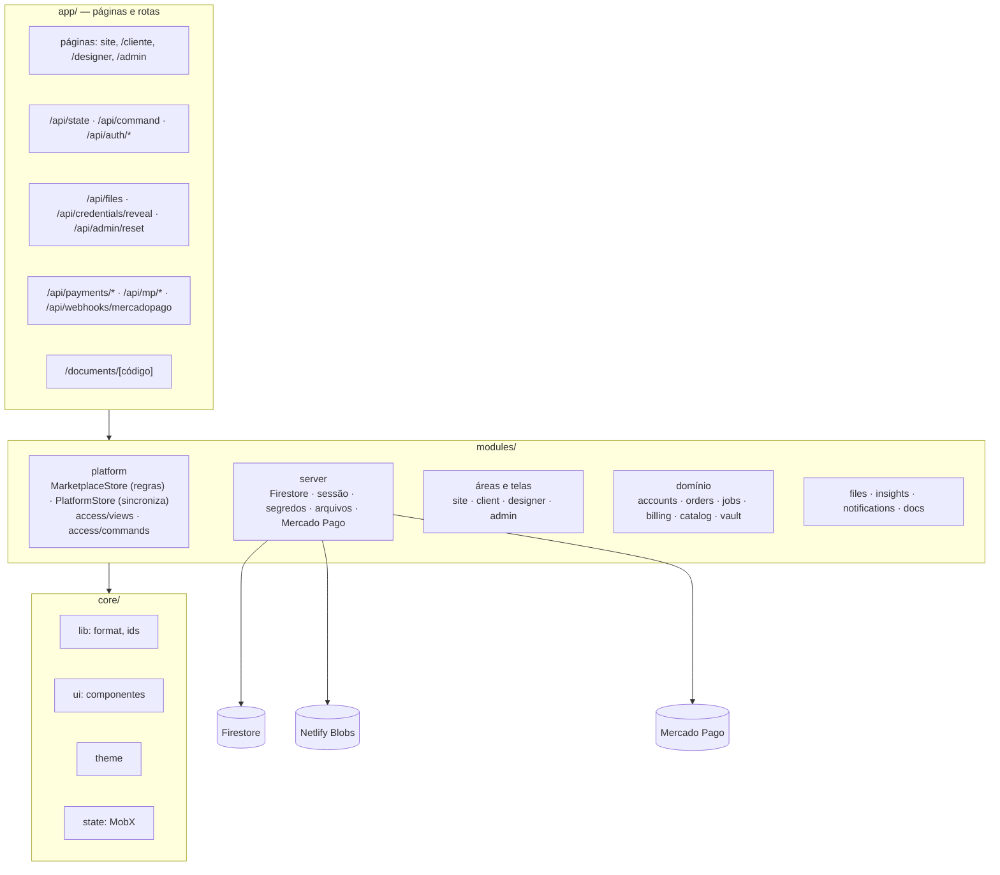
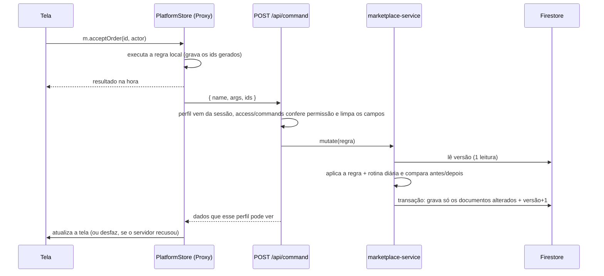
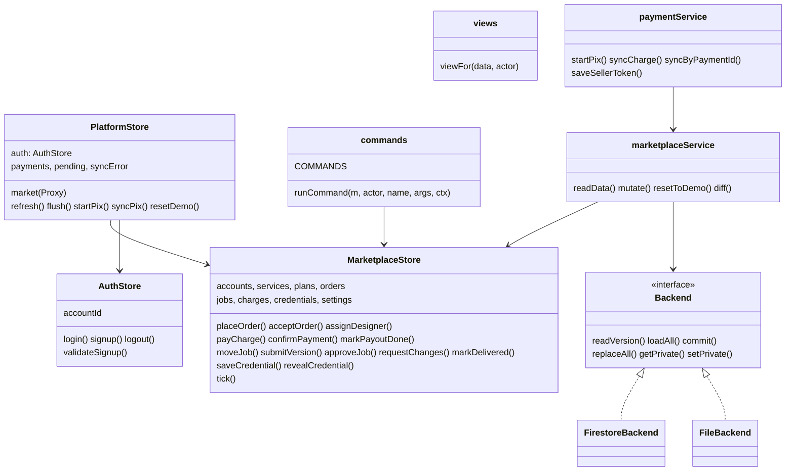

# 3. Arquitetura e classes

## 3.1 Camadas

Organização **modular por funcionalidade**: **`app` → `modules` → `core`**. Toda regra de negócio fica num único lugar (`MarketplaceStore`) e é **a mesma** no navegador e no servidor.

## 3.2 Como a tela conversa com o servidor

As telas chamam os métodos do `MarketplaceStore` normalmente (resposta instantânea). Um **Proxy** no `PlatformStore` percebe cada ação que deu certo e a envia ao servidor com os **mesmos argumentos e os mesmos ids** gerados no navegador. O servidor repete a ação com as mesmas regras — mas com o **perfil da sessão**, nunca o que o navegador diz — e grava só o que mudou.

**Concorrência:** a transação confere a versão dos dados; se outro usuário gravou antes, a ação é refeita sobre os dados novos (até 4 tentativas).

**Cache:** cada instância do servidor guarda os dados em memória e só relê tudo quando a versão muda — normalmente **1 leitura por requisição**.

## 3.3 Classes principais

## 3.4 Decisões

| Decisão | Por quê |
| --- | --- |
| Regras num só lugar, repetidas no servidor | As telas já existiam com regras completas; o servidor reaproveita o mesmo código, sem duplicar lógica |
| Ids gerados no navegador e repetidos no servidor | Tela e banco ficam com os mesmos registros (ex.: abrir o pedido recém-criado). O servidor só aceita ids novos e no formato certo |
| Firestore só pelo servidor (regras do banco: tudo bloqueado) | Nenhuma chave do Firebase vai para o navegador; o servidor decide o que cada perfil vê |
| Um documento por registro + documento de versão | Grava só o que mudou (economiza a cota gratuita) e evita sobrescrever alterações de outros usuários |
| Arquivos no Netlify Blobs, em partes de 4 MB | Firebase Storage exige plano pago; funções do Netlify aceitam até 6 MB por requisição |
| Banco local em arquivo (`.data/`) quando não há credencial | Desenvolver e testar sem gastar a cota do Firebase |
| Mercado Pago desligado sem credencial | O código vai para produção pronto e "oculto"; liga ao configurar as variáveis |
| Datas no fuso de Brasília | O servidor do Netlify roda em UTC; sem isso, servidor e navegador mostravam horários diferentes (INC-07) |
