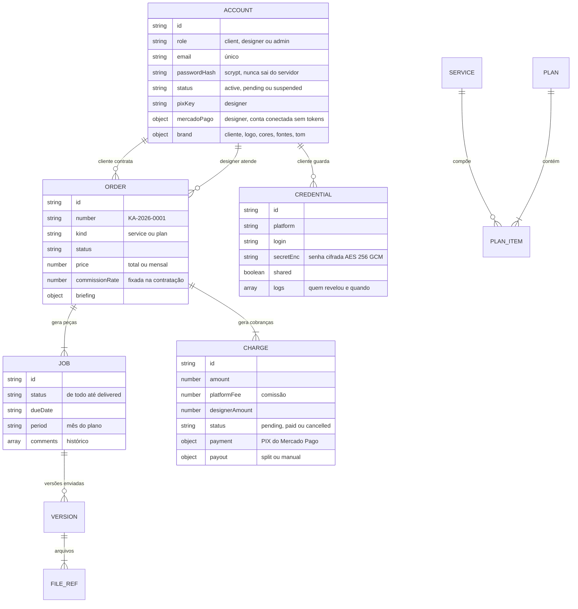

# 4. Modelo de dados

## 4.1 Entidades

## 4.2 Onde cada dado fica

| Dado | Onde | Observação |
| --- | --- | --- |
| Contas, serviços, planos, pedidos, peças, cobranças, cofre | **Firestore**, coleções `accounts`, `services`, `plans`, `orders`, `jobs`, `charges`, `credentials` | Um documento por registro; campo `_seq` guarda a ordem das listas |
| Configurações, contador de pedidos, versão dos dados | Firestore, documento `meta/state` | A versão aumenta a cada gravação (controle de concorrência) |
| Tokens do Mercado Pago dos designers | Firestore, coleção `private` (cifrados) | Nunca enviados ao navegador; não fazem parte dos dados da plataforma |
| Arquivos das entregas e miniaturas | **Netlify Blobs**, loja `kreativeart-files` | `<id>/meta` + partes `<id>/0`, `<id>/1`…; leitura imediata (consistência forte) |
| Sessão de login | Cookie `ka_session` (HttpOnly, assinado) | Só o id da conta e a validade (7 dias) |
| Chaves do servidor | Variáveis do Netlify (`SESSION_SECRET`, `VAULT_KEY`, `FIREBASE_*`) | Localmente: `.env.local` e `firebase-service-account.json` (fora do git e do pacote publicado) |

O **Firestore** está em **modo de produção** (regras bloqueando qualquer acesso direto). Só o servidor acessa, com a conta de serviço.

## 4.3 O que cada perfil recebe

| Dado | Visitante | Cliente | Designer | KreativeArt |
| --- | --- | --- | --- | --- |
| Catálogo e planos | ✅ | ✅ | ✅ | ✅ |
| Perfil público dos designers | ✅ | ✅ | ✅ | ✅ |
| Pedidos / peças / cobranças | — | os próprios | abertos + os dele | todos |
| Dados de clientes | — | o próprio | só clientes dos pedidos (sem CPF/CNPJ e e-mail) | todos |
| Chave PIX do designer | — | só dos designers dos pedidos dele | a própria | todas |
| Cofre de acessos | — | o próprio, com senha | sem senha (revela sob registro) | sem senha |
| Hash de senha | — | — | — | — |

Regras em `src/modules/platform/access/views.ts`, testadas em UT-05 e API-01 a API-04.

## 4.4 Cota gratuita do Firebase (Spark)

| Limite diário | Uso típico |
| --- | --- |
| 50 mil leituras | 1 leitura por requisição (versão); recarga completa (~150 documentos) só quando outra instância gravou |
| 20 mil gravações | 1 ação = documentos alterados + 1 (versão). Restaurar a demonstração ≈ 150 gravações + apagamentos |

> Lição do SuperCell (INC-07 daquele projeto): não restaurar a demonstração repetidas vezes; os testes completos rodam primeiro no banco local (`DATA_STORE=file`).
