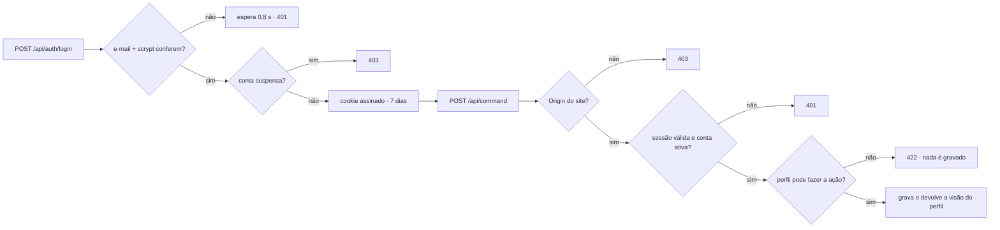

# 5. Segurança

## 5.1 Ameaças e proteções

| # | Ameaça | Proteção | Teste |
| --- | --- | --- | --- |
| S1 | Roubo de senhas do banco | Senhas com **scrypt** e sal aleatório; o hash nunca sai do servidor | UT-07, API-03 |
| S2 | Adivinhar senha | Espera de 0,8 s a cada erro; mensagem genérica ("e-mail ou senha incorretos") | API-02 |
| S3 | Roubo ou falsificação da sessão | Cookie **HttpOnly**, **SameSite=Lax**, *Secure*, assinado com HMAC-SHA256, 7 dias; conta suspensa perde o acesso na hora | API-02 |
| S4 | Fingir ser outro perfil (ex.: cliente aprovando como admin) | O perfil vem **só da sessão**; cada ação confere quem pode fazê-la (`access/commands.ts`) | UT-06, API-05 |
| S5 | Mandar campos extras (trocar papel, status, senha) | Cada ação aceita só campos conhecidos, com tipo e tamanho limitados | UT-06 |
| S6 | Ver dados de outros clientes | O servidor envia a cada perfil só o que ele pode ver (`access/views.ts`) | UT-05, API-01–04 |
| S7 | Vazamento das senhas do cofre | **AES-256-GCM** com chave fora do banco (`VAULT_KEY`); o designer recebe a senha só ao **revelar**, com pedido ativo, e fica registrado | UT-07, API-07 |
| S8 | CSRF (outro site fazendo ações com a sessão do usuário) | Alterações só com `Origin` do próprio site + JSON + cookie SameSite | API-06 |
| S9 | Baixar arquivo de entrega de outro cliente | Só quem enviou, a KreativeArt ou quem participa da peça | API-08 |
| S10 | Enviar arquivo malicioso | Lista de formatos aceitos; 60 MB no máximo; partes conferidas pelo tamanho; entregue como `application/octet-stream` com `nosniff` e CSP `default-src 'none'` | API-08 |
| S11 | Link "javascript:" no logo/portfólio | Só links `https://` são aceitos | UT-06 |
| S12 | XSS, clickjacking | CSP, `X-Frame-Options: DENY`, `nosniff`, `Referrer-Policy`, `Permissions-Policy`, HSTS | PRD-03 |
| S13 | Chaves no pacote publicado | `npm run deploy` tira `.env*`, `.data` e a chave do Firebase da pasta durante o build; conferido que nenhum valor secreto está no pacote | INC-06 |
| S14 | Pagamento falso | Com Mercado Pago ligado, só a consulta ao Mercado Pago (ou a KreativeArt) confirma; confere o valor e a referência; webhook com assinatura `x-signature` | UT-08 |
| S15 | Token do designer no Mercado Pago | Guardado cifrado na coleção `private`, nunca enviado ao navegador; "state" do OAuth assinado e com validade de 15 min | — |

## 5.2 Do login à ação

## 5.3 Pendências e recomendações

| Item | Prioridade |
| --- | --- |
| Arquivos **SVG** enviados como prévia são exibidos pelo navegador; um SVG com script poderia rodar se aberto em nova aba. Recomendação: converter SVG em PNG no envio ou aceitar SVG só como arquivo final | Média |
| Limitar tentativas de login por IP/conta (hoje: espera de 0,8 s por erro) | Baixa |
| "Esqueci minha senha" (hoje a KreativeArt redefine manualmente) — usar Firebase Authentication ou e-mail com link | Média |
| Termos de uso e política de privacidade (LGPD: CPF/CNPJ, telefone, acessos do cofre) | Média |
| Versões antigas no histórico do Netlify (antes do INC-06) contêm `.env.local` no código do servidor — não são públicas, mas podem ser apagadas no painel do Netlify (Deploys) | Baixa |
