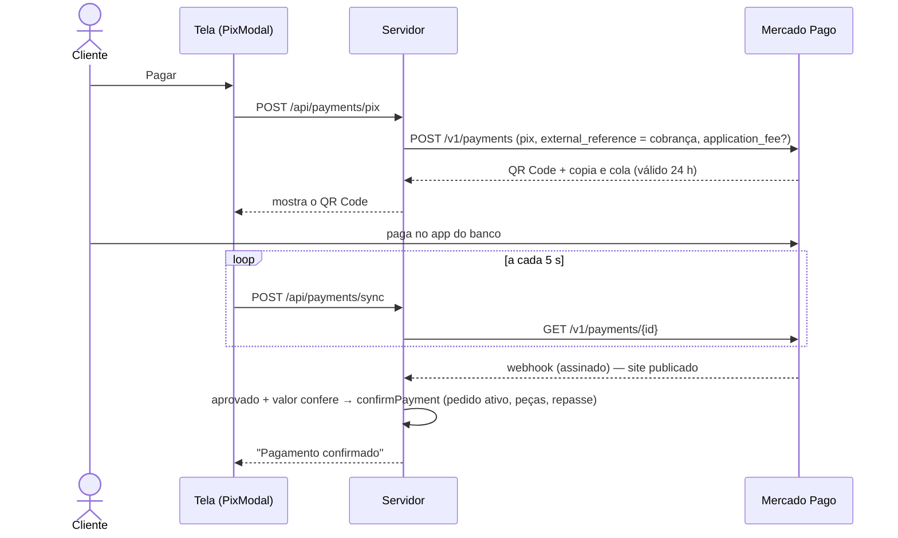

# 6. Pagamentos (Mercado Pago)

## 6.1 Decisões do responsável (10/10/2026)

- **Só PIX** — QR Code ou copia e cola.
- **Divisão automática (split):** o designer conecta a conta Mercado Pago; cada PIX é dividido na hora (90% designer, 10% KreativeArt).
- Confirmação **automática** pelo retorno do Mercado Pago, mudando as situações sozinhas.
- Como é um projeto de **portfólio** e a validação da conta no Mercado Pago ficou bloqueada por 24 h, a integração ficou **pronta e oculta**: sem credenciais, o site usa o **modo demonstração**.

## 6.2 Os três modos

| Modo | Quando | O que acontece |
| --- | --- | --- |
| **Demonstração** (atual) | Sem `MP_ACCESS_TOKEN` | O cliente clica em "Pagar com PIX", a tela mostra "Gerando o PIX…" e "Aguardando a confirmação…", e a cobrança é aprovada. Pedido ativa e produção começa, como no real |
| **Split** | Credenciais + designer com conta conectada | PIX criado com o token do designer e `application_fee` = comissão. O Mercado Pago deposita cada parte direto. Repasse: "Automático" |
| **Conta da KreativeArt** | Credenciais, designer sem conta conectada, **ou** o Mercado Pago recusou o split no PIX | PIX criado na conta da KreativeArt. Depois de pago, o painel mostra "repasse a fazer" com a chave PIX do designer; a KreativeArt faz o PIX e clica em **Marcar repasse feito** |

> **Ponto a confirmar no teste:** a documentação do Mercado Pago confirma o split com `application_fee`, mas uma página oficial diz que PIX no Checkout Transparente não está disponível para marketplaces. O sistema tenta o split e, se o Mercado Pago recusar, usa a conta da KreativeArt automaticamente — o cliente não percebe diferença.

## 6.3 Sequência do PIX

| Arquivo | Papel |
| --- | --- |
| `src/modules/server/payments/mercadopago.ts` | Chamadas à API (PIX, consulta, OAuth) e configuração |
| `src/modules/server/payments/payment-service.ts` | Gera/reaproveita o PIX, escolhe split ou conta da KreativeArt, confirma, tokens dos designers |
| `src/app/api/payments/pix` · `sync` | Gerar o PIX e "já pagou?" |
| `src/app/api/webhooks/mercadopago` | Notificações (assinatura `x-signature` + reconsulta) |
| `src/app/api/mp/connect` · `callback` · `disconnect` | Conexão da conta do designer (OAuth) |
| `src/modules/billing/components/BillingParts.tsx` | Tela do PIX, modo demonstração, coluna de repasse, cartão "Conectar Mercado Pago" |

## 6.4 Como ativar o pagamento real

1. Em **mercadopago.com.br/developers → Suas integrações → Criar aplicação**: nome **KreativeArt**, pagamentos online, sem plataforma de e-commerce, **Checkout Transparente (API)**, modelo **Marketplace**.
2. Na aplicação, configure:
   - **URL de redirecionamento (OAuth):** `https://kreativeart.netlify.app/api/mp/callback`
   - **Webhooks:** URL `https://kreativeart.netlify.app/api/webhooks/mercadopago`, evento **Pagamentos**; copie a **assinatura secreta**.
3. Para testar no computador, preencha em `.env.development.local`: `MP_ACCESS_TOKEN` (credencial de **teste**), `MP_CLIENT_ID`, `MP_CLIENT_SECRET`, `MP_TEST_MODE=true`.
4. Para o site publicado, cadastre no Netlify as mesmas variáveis + `MP_WEBHOOK_SECRET` e publique (`npm run deploy`).
5. Teste: no ambiente de teste, o comprador é enviado com nome **"APRO"**, que pede aprovação automática do PIX. Confirme: QR Code aparece → cobrança vira "Pago" sozinha → pedido "Em andamento".
6. Conecte a conta de um designer de teste (Perfil e PIX → **Conectar Mercado Pago**) e repita: o repasse deve aparecer como "Automático (Mercado Pago)". Se aparecer "A receber da KreativeArt", o Mercado Pago recusou o split no PIX (ver log do servidor).
7. Produção: troque pelas credenciais **de produção** e retire `MP_TEST_MODE`.
