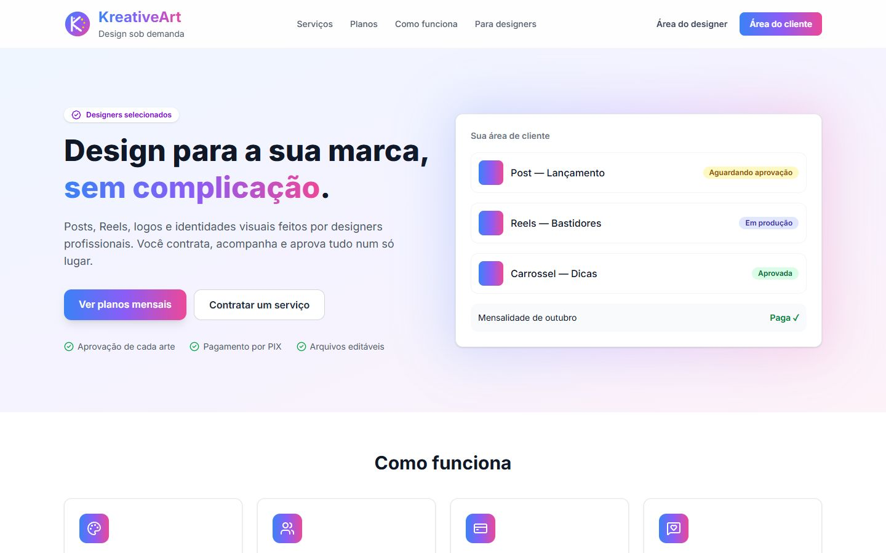
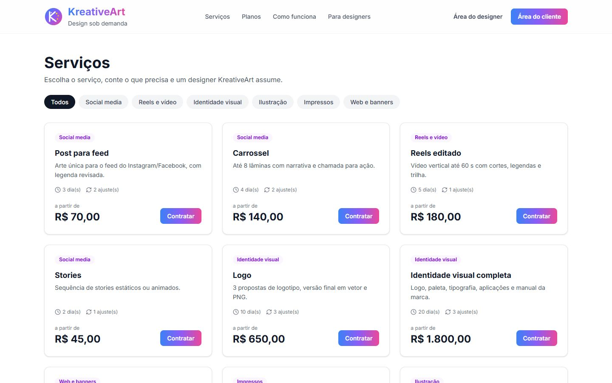
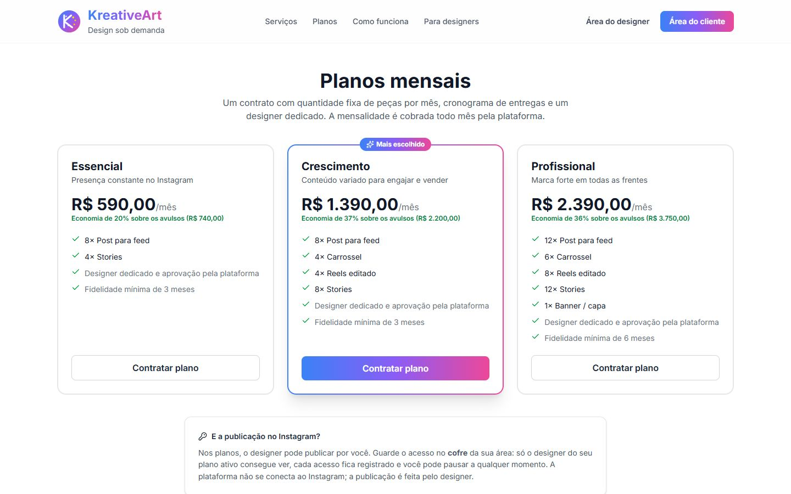

# KreativeArt — design sob demanda

Marketplace de design: **empresas contratam** serviços avulsos ou planos mensais, **designers cadastrados aceitam** os pedidos e produzem, o **cliente aprova** cada arte pela plataforma e **paga por PIX**. A **KreativeArt fica com uma comissão** (10% por padrão) e acompanha tudo num painel de gestão.

**Publicado:** https://kreativeart.netlify.app · **Status (10/10/2026):** completo e **pausado** — banco de dados real (Firestore), login no servidor, arquivos no Netlify Blobs; pagamento PIX pelo Mercado Pago **pronto e oculto** (modo demonstração até configurar as credenciais).

- **Stack:** Next.js 16 · React 19 · TypeScript · Tailwind CSS 4 · MobX · Firebase Firestore (Admin SDK) · Netlify Blobs · Mercado Pago · ag-psd e fflate (prévia de PSD/CDR) · Vitest · Puppeteer
- **Dados da empresa:** fictícios (configuráveis em `/admin/configuracoes`)
- **Documentação:** [`Documents/`](Documents/README.md) · **Testes:** [`Testes/`](Testes/README.md) · no site: link secreto `/documents/<código>` (`src/modules/docs/docs-access.ts`)

## Telas

**Página inicial**



**Catálogo de serviços**



**Planos mensais**



## Rodando

```bash
npm install
npm run dev        # http://localhost:3000 (sem a chave do Firebase, usa o banco local .data/)
npm test           # testes unitários
npm run db:setup   # cria as chaves locais e grava os dados demonstrativos no Firestore (uma vez)
npm run deploy     # publica no Netlify (ver Documents/07)
```

**Acesso demonstrativo** (senha `demo123`, com botões de acesso rápido na tela de login):

| Perfil | E-mail | Situação |
| --- | --- | --- |
| KreativeArt (gestão) | `admin@kreativeart.com` | — |
| Designer | `ana@kreativeart.com` | cumprindo a meta |
| Designer | `bruno@kreativeart.com` | atrasando |
| Designer | `diego@kreativeart.com` | sem pedidos ativos |
| Designer | `carla@kreativeart.com` | cadastro em análise |
| Cliente | `contato@techsolutions.com` | plano Crescimento, artes para aprovar |
| Cliente | `comercial@fashionstore.com` | plano Essencial + pedidos avulsos |
| Cliente | `contato@cafearoma.com` | mensalidade em atraso → produção pausada |

"Restaurar demonstração" (painel da KreativeArt) volta tudo ao estado inicial.

## Áreas e rotas

| Site público | Cliente (`/cliente`) | Designer (`/designer`) | KreativeArt (`/admin`) |
| --- | --- | --- | --- |
| `/` início, como funciona, FAQ | Visão geral | Visão geral + meta de pontualidade | Painel (indicadores e alertas) |
| `/servicos` serviços avulsos | Aprovações (aprovar / pedir ajuste) | Oportunidades (aceitar pedidos) | Inteligência (gráficos e ranking) |
| `/planos` planos mensais | Meus pedidos | Quadro de produção (estilo Trello) | Pedidos (atribuir/transferir designer) |
| `/designers` seja designer | Financeiro (pagar por PIX) | Calendário | Entregas (atrasadas, com o cliente) |
| `/contratar/...` (exige cadastro) | Calendário | Ganhos | Designers (aprovar, suspender, metas) |
| `/entrar`, `/cadastro/cliente`, `/cadastro/designer` | Acessos (cofre do Instagram) | Perfil e chave PIX | Clientes · Financeiro · Serviços e planos · Configurações |
| | Perfil e identidade da marca | | |

## Regras principais

- **Pedido:** aguardando designer → (designer aceita) aguardando pagamento → (cliente paga) em andamento → concluído. Cancelável pelo cliente só antes de começar.
- **Pagamento:** PIX pelo Mercado Pago com divisão automática (designer conectado) ou recebido pela KreativeArt com repasse; hoje em **modo demonstração** (aprova automaticamente). Ver `Documents/06`.
- **Planos:** uma mensalidade por mês; as peças do mês são distribuídas no calendário. Mensalidade atrasada além da tolerância (5 dias) → **produção do mês pausada**.
- **Peças:** a fazer → em produção → aguardando aprovação → (ajustes → nova versão) → aprovada → entregue/publicada. Ajustes além do incluído ficam marcados como "ajuste extra".
- **Arquivos:** prévia obrigatória (JPG, PNG, WEBP, GIF, SVG, MP4, WEBM, MOV, PDF) e arquivos finais (PSD, AI, CDR, EPS, SVG, TIFF, INDD, FIG, ZIP…). **PSD e CDR ganham miniatura automática**; AI abre como PDF. Os editáveis só são liberados ao cliente após a aprovação.
- **Cofre de acessos:** só o designer de um pedido **ativo** revela a senha; cada revelação fica registrada para o cliente, que pode pausar o acesso a qualquer momento.
- **Metas dos designers:** % de peças com a 1ª versão no prazo (meta 90%) e peças atrasadas; níveis "cumprindo a meta", "atenção" e "atrasando", com alertas no painel.

## Testes

Resultados e roteiros em [`Testes/`](Testes/README.md): 27 unitários, 9 fluxos, 30 páginas, 8 verificações de segurança da API e verificações em produção.

```bash
npm test                                        # 27 testes unitários
npx next dev -p 3005                            # em outro terminal, para os testes com navegador:
npm run test:smoke -- http://localhost:3005     # 30 páginas com cada perfil
npm run test:flows -- http://localhost:3005     # 9 fluxos completos
npm run test:api -- http://localhost:3005       # 8 verificações de segurança
```

## Arquitetura

`app` (páginas e rotas de API) → `modules` → `core`. Toda a regra de negócio fica em `modules/platform/marketplace-store.ts`: a tela a executa na hora e o servidor repete a mesma ação (com o perfil da sessão) antes de gravar no Firestore. Detalhes em [`Documents/03`](Documents/03-arquitetura-e-classes.md).
