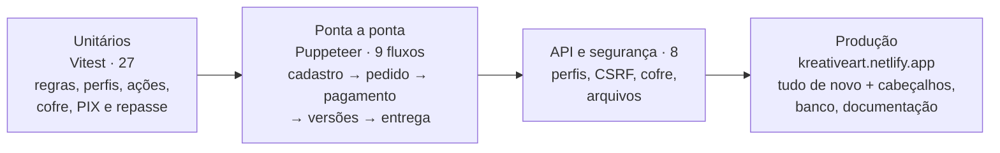

# Testes — KreativeArt

**Última execução:** 10/10/2026 · **Resultado geral:** ✅ aprovado

## Resumo

| Nível | Documento | Casos | Resultado |
| --- | --- | --- | --- |
| Unitários (automatizados) | [01-unitarios.md](01-unitarios.md) | 27 | ✅ 27/27 |
| Ponta a ponta (navegador real) | [02-ponta-a-ponta.md](02-ponta-a-ponta.md) | 9 fluxos + 30 páginas | ✅ 9/9 · 30/30 |
| API e segurança | [03-api-e-seguranca.md](03-api-e-seguranca.md) | 8 | ✅ 8/8 |
| Produção (Netlify + Firestore) | [04-producao.md](04-producao.md) | 5 grupos + fluxos + API + páginas + documentação | ✅ |
| Incidentes | [05-incidentes.md](05-incidentes.md) | 14 | ✅ resolvidos / contornados |

As saídas brutas de cada execução estão em [`resultados/`](resultados/).

## Estratégia



**Banco nos testes:** os fluxos completos rodam primeiro no banco local (`DATA_STORE=file`) e depois no Firestore. Depois de cada rodada no Firestore, os dados demonstrativos são restaurados (`npm run db:setup`) para o portfólio ficar limpo.

## Como rodar de novo

Na pasta do projeto:

```bash
npm test
```

Com o site local rodando (`npx next dev -p 3005`), em outro terminal:

```bash
npm run test:flows -- http://localhost:3005
```

```bash
npm run test:api -- http://localhost:3005
```

```bash
npm run test:smoke -- http://localhost:3005
```

Produção:

```bash
node tests/e2e/producao.mjs https://kreativeart.netlify.app
```

> Os fluxos criam um cliente e um pedido de teste. Depois de rodar no Firestore, restaure a demonstração com `npm run db:setup`.

## Não testado (depende de credenciais externas)

| Item | Por quê |
| --- | --- |
| PIX real no Mercado Pago (QR Code, confirmação, webhook) | Validação da conta no Mercado Pago bloqueada (INC-11). Coberto por testes unitários (UT-08) e pelo modo demonstração; roteiro de teste em [Documents/06](../Documents/06-pagamentos-mercado-pago.md#64-como-ativar-o-pagamento-real) |
| Conexão da conta Mercado Pago do designer (OAuth) | Idem |
